<!-- Generated by scripts/build_assets.py — edit the script, not this file. -->

 

 

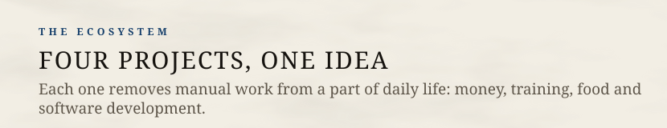

<a href="https://github.com/PabloRS98/finance-tracker">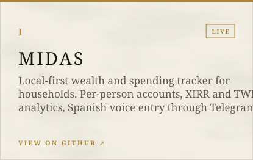</a>
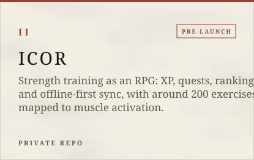
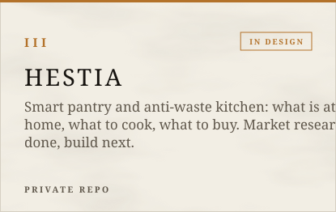
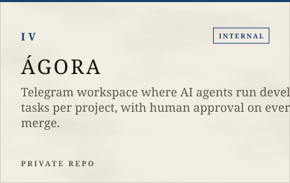

 

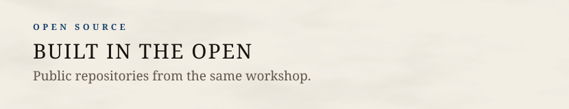
<a href="https://github.com/PabloRS98/projects-dashboard">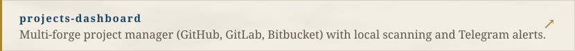</a>
<a href="https://github.com/PabloRS98/Content-Media-Manager">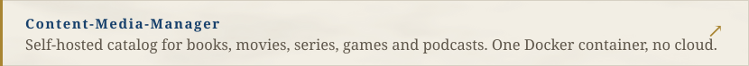</a>
<a href="https://github.com/PabloRS98/finance-tracker">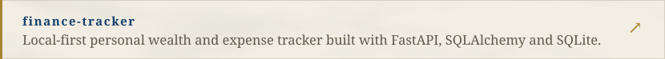</a>

🇬🇧 English · <a href="#-en-español">🇪🇸 Léelo en español</a>

 

> [!TIP]
> **Open to junior developer roles, internships and collaborative projects.** Fastest way to reach me: [email](mailto:pablorgz98@gmail.com) or [LinkedIn](https://www.linkedin.com/in/pablors98).

<b>🧠 How my agents talk to each other</b>

 

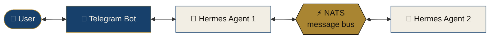

<b>📈 Activity</b> (auto-updated)

 

<picture>
  <source media="(prefers-color-scheme: dark)" srcset="https://raw.githubusercontent.com/PabloRS98/PabloRS98/output/github-snake-dark.svg">
  
</picture>

**Latest repositories**

<!--START_SECTION:repos-->
| Repository | Description | Language | Last push |
|---|---|---|---|
| [finance-tracker](https://github.com/PabloRS98/finance-tracker) | Local-first personal net worth, portfolio, and expense tracker built with FastAPI, SQLAlchemy & SQLite | `Python` | 2026-11-14 |
| [projects-dashboard](https://github.com/PabloRS98/projects-dashboard) | Self-hosted multi-forge project dashboard (GitHub/GitLab/Bitbucket) with local git scanning and Telegram alerts | `Python` | 2026-11-14 |
| [Content-Media-Manager](https://github.com/PabloRS98/Content-Media-Manager) | Self-hosted catalog for books, movies, series, games and podcasts. No cloud, no paid APIs, one Docker container | `Python` | 2026-11-14 |
<!--END_SECTION:repos-->

**Recent commits**

<!--START_SECTION:activity-->
- `2026-11-14` · [PabloRS98/finance-tracker](https://github.com/PabloRS98/finance-tracker) — [docs: translate README to English and ignore local agent dirs](https://github.com/PabloRS98/finance-tracker/commit/165f09ccc64664381c3cb54ad3b87564014cdfdc)
- `2026-11-14` · [PabloRS98/projects-dashboard](https://github.com/PabloRS98/projects-dashboard) — [docs: translate README/CI to English, add MIT license and remove local scratch a](https://github.com/PabloRS98/projects-dashboard/commit/13249cfd50eca9a06e5308694a634199b6e75936)
- `2026-11-14` · [PabloRS98/Content-Media-Manager](https://github.com/PabloRS98/Content-Media-Manager) — [chore: untrack .claude settings and ignore local agent dirs](https://github.com/PabloRS98/Content-Media-Manager/commit/20551c3f7eae27a0627dbee4be7065f10d191ecd)
- `2026-10-28` · [PabloRS98/Content-Media-Manager](https://github.com/PabloRS98/Content-Media-Manager) — [Merge pull request #67: 1.1.0, rediseño y tercera auditoría](https://github.com/PabloRS98/Content-Media-Manager/commit/0dfc1573f06570619164230ddbc44f0f5ab3b402)
- `2026-10-28` · [PabloRS98/Content-Media-Manager](https://github.com/PabloRS98/Content-Media-Manager) — [Lint con el ruff fijado (0.7.4): UP038 y UP027](https://github.com/PabloRS98/Content-Media-Manager/commit/a46697401e0349b0778ec51e16fe8837f1ba079d)
<!--END_SECTION:activity-->

 

---

<h2 id="-en-español">🇪🇸 En español</h2>

<b>Haz clic para desplegar la versión en español</b>

 

 

 

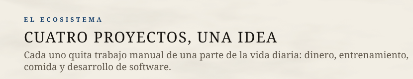

<a href="https://github.com/PabloRS98/finance-tracker">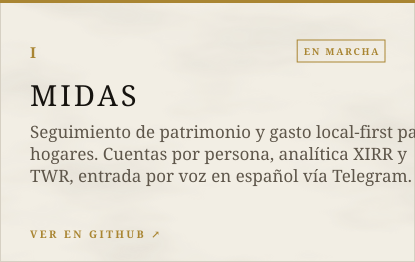</a>
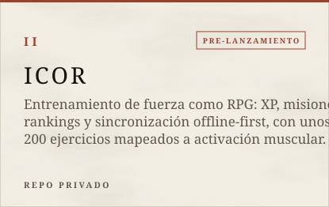
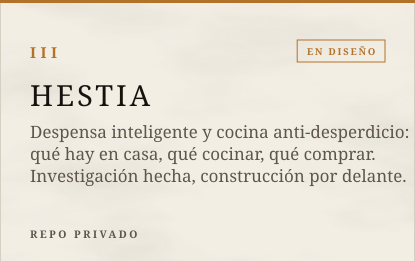
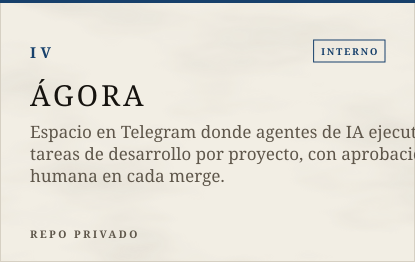

 

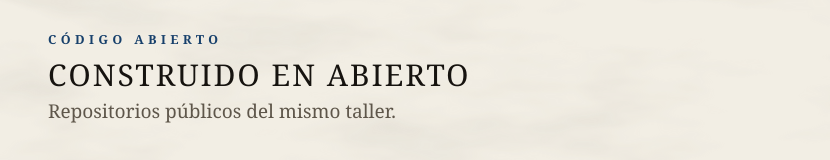
<a href="https://github.com/PabloRS98/projects-dashboard">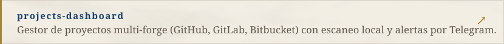</a>
<a href="https://github.com/PabloRS98/Content-Media-Manager">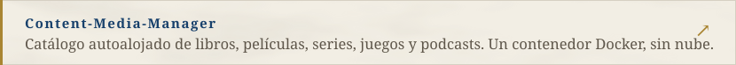</a>
<a href="https://github.com/PabloRS98/finance-tracker">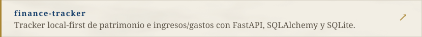</a>

💡 **Abierto a puestos junior, prácticas y proyectos en colaboración.** Contacto rápido: [email](mailto:pablorgz98@gmail.com) o [LinkedIn](https://www.linkedin.com/in/pablors98).

<a href="#top">⬆️ Volver arriba</a>

